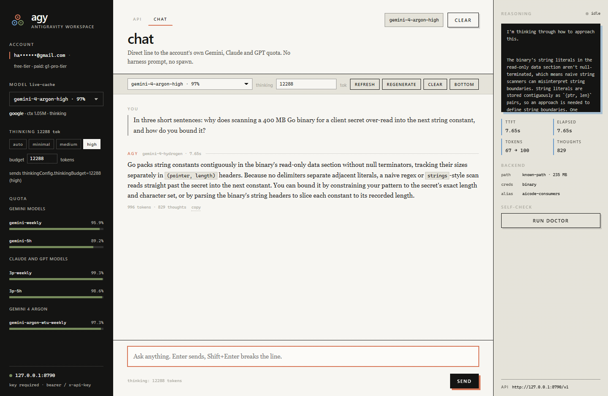

# agy — Antigravity as an OpenAI / Claude endpoint

A local Windows app and HTTP API that answers with the **account's own
Antigravity quota** — the same models, the same backend — without the agent
harness that ships inside `agy.exe`.

Point any OpenAI-compatible client (Cline, Roo, Continue, aider, the `openai`
SDK) or any Claude-native client at `http://127.0.0.1:8790/v1` and it works.
Same port, same key store, one window with an API tab and a chat tab.


---

## Why this exists

Antigravity's CLI (`agy.exe`) can answer without an API key, which means it can
answer on the account's subscription quota. But every call it makes carries the
vendor's own agent scaffolding:

| what the stock client sends | cost |
|---|---|
| `request.systemInstruction` — 65,891 chars of client-built prompt | ~16.5k tokens |
| `request.tools` — 14 tool declarations | ~5k tokens |
| a separate `agent_monitoring` "Proctor" rater request per tool call | 2,704 tokens |
| one 235 MB `agy.exe` process per turn | ~7 s startup |

Measured for the same three-word reply: **21,830 prompt tokens** through
`agy -p`, versus **6–38 prompt tokens** on the direct path this repo implements.

The prompt, the tools, the rater and the hub are all **client-side** — that is
the whole finding this project is built on. The model does not need them.

## What it bypasses, and what it does not

**Removed here, because it lives in the client:**

- the 16.5k-token system prompt (`POST /v1internal:streamGenerateContent` body)
- the 14 tool declarations, and the agent loop that drove them
- the `agent_monitoring` / Proctor tool-call rater request
- the 235 MB process spawn per turn
- the local "hub" control plane and its plaintext CSRF token
- the official-client telemetry replay some proxies perform (this project does
  **not** fake it)

**Not bypassed, because it lives on Google's side:**

- the content filter on request text. It arrives as a perfectly normal HTTP 200
  whose candidate text reads `This request was blocked by Gemini's filters…`
- model-level refusals
- per-account quota (`gemini-weekly`, `gemini-5h`, `3p-weekly`, `3p-5h`,
  `gemini-argon-wtu-weekly`)

Transport tricks never moved those, and this project does not pretend to. What
changes is cost, latency and integration.

## Is the Antigravity window needed?

**No.** The app talks straight to `daily-cloudcode-pa.googleapis.com`. The IDE,
the CLI binary and the local hub can all be closed. What it needs from the
installed client is exactly one thing: the **OAuth refresh token** the client
already wrote into the Windows Credential Manager (`gemini:antigravity`). It
reads it once, caches it, and refreshes on its own from then on.

If the client is uninstalled, the token keeps working until Google revokes it.
If the binary is gone, the built-in OAuth client pair is used. If the credential
store is empty, seed a token with `--login-token`.

## Quickstart

```powershell
git clone <this repo> agy
cd agy

# one-time: resolve the install, check the chain, mint a local API key
powershell -ExecutionPolicy Bypass -File agy-direct\setup.ps1

# open the app (starts the server, opens its own window)
app\agy-app.cmd
```

Requirements: Windows, Node 20+, and an Antigravity install you have signed into
once. No npm packages, no bundled binaries, no build step.

## Use it as an API

The app serves an OpenAI-compatible surface **and** a Claude-compatible one on
the same port. Keys are `agy_…`, created and revoked in the **API** tab.

```python
from openai import OpenAI

client = OpenAI(base_url="http://127.0.0.1:8790/v1", api_key="agy_…")

r = client.chat.completions.create(
    model="gemini-3.8-flash-low",
    thinking_budget=8192,          # token budget: 512 … 32768, 0 = off
    messages=[{"role": "user", "content": "hi"}],
)
print(r.choices[0].message.content)
```

```bash
curl http://127.0.0.1:8790/v1/messages \
  -H "content-type: application/json" \
  -H "Authorization: Bearer agy_…" \
  -d '{"model":"gemini-4-hydrogen-high","max_tokens":200,
       "thinking":{"type":"enabled","budget_tokens":8192},
       "messages":[{"role":"user","content":"hi"}]}'
```

| endpoint | shape |
|---|---|
| `POST /v1/chat/completions` | OpenAI — stream, non-stream, `tools`, `tool_choice`, `reasoning_effort`, `thinking_budget` |
| `POST /v1/messages` | Claude Messages — stream, non-stream, `tools.input_schema`, `thinking.budget_tokens` |
| `POST /v1/completions` | legacy text completion |
| `GET /v1/models`, `/v1/models/{id}` | live per-account catalog, `?quota=1`, `?refresh=1` |
| `GET /v1/quota`, `/v1/tier` | quota buckets, tier, project |
| `GET /health`, `/v1/doctor` | self-check, no model quota consumed |

Key headers: `Authorization: Bearer`, `x-api-key`, `api-key`. A legacy
`AGY_TOKEN` or `config.api_key` keeps working alongside the store.

## Thinking control is a number, not a word

The wire knob is `generationConfig.thinkingConfig.thinkingBudget`. Words are UI
convenience presets that map to budgets; a word the model does not carry is a
hard 400 from the backend (`Thinking level MINIMAL is not supported…`), which is
why budgets ship instead.

| budget | thought tokens spent (same prompt) |
|---|---|
| 1024 | 153 |
| 8192 | 348 |
| 30000 | 1218 |

Thoughts stream to `delta.reasoning` (OpenAI), `thinking_delta` (Claude), and the
app's reasoning panel. `max_tokens` is raised by the budget automatically,
because thoughts count against the output cap.

## The app



Two views:

**API** (default) — base URL with copy, the key table (create / copy / rotate /
disable / revoke, last-used time and request count per key), and curl / python /
node quickstarts that carry the key you picked.

**Chat** — the same engine with a window: model picker, thinking chips plus a
numeric budget box, live reasoning panel with TTFT / elapsed / tokens / thought
tokens, and a toolbar with refresh, stop, regenerate, clear and scroll-to-bottom.
History persists across window restarts.

## How it works

```
app\agy-app.cmd
  └─ app/server.mjs                        UI + /api/* + /v1/*
       └─ agy-direct/lib/client.mjs        one HTTPS POST per turn
            └─ daily-cloudcode-pa.googleapis.com/v1internal:streamGenerateContent
                 Authorization: Bearer <access token from the refresh token>
```

Credential chain (all discovered, nothing hardcoded to a path):

1. **refresh token** — Windows Credential Manager, every generic credential is
   scanned and the one carrying a Google refresh token is adopted
2. **OAuth client id/secret** — extracted from the installed `agy.exe` and each
   pair verified against `oauth2.googleapis.com/token` before use
3. **binary** — `AGY_BIN` → config → known dirs → registry uninstall entries →
   running process → `PATH` → bounded scan; only `agy*.exe` accepted
4. **model catalog** — `v1internal:fetchAvailableModels`, per account, cached

Everything above is re-derived when it stops working, so a vendor update is a
rescan rather than a breakage:

| update breaks | recovery |
|---|---|
| client id/secret re-signed | pair marked stale → binary rescanned → every pair re-validated |
| binary replaced or moved | fingerprint (`size:mtime`) mismatch → revalidate → rescan |
| keyring target renamed | full credential scan, next candidate adopted in the same pass |
| refresh token rotated | store re-read; if it did not move, the pair is rescanned |

Ported hardening, each verified on a live account:

- **upstream fallback** `daily → sandbox → production`, moving only on network
  errors and 5xx and never after the first byte (`production` answered 429 for a
  free-tier account while `daily` and `sandbox` answered 200)
- **account pool** — several refresh tokens rotate per request; 429 →
  exponential cooldown, 403 → ten minutes and disabled after three,
  `invalid_grant` → disabled at once
- **SSE heartbeat** every 15 s so a quiet thinking run does not look dead
- **tool calling** with `thoughtSignature` packed into the tool-call id, so the
  tool loop survives restarts without server-side state

## Verification

Everything claimed here was run on a real account on 2026-11-18.

```
$ node agy-direct\cli.mjs --doctor
OK  binary        …\.gemini\bin\agy.exe (235 MB via known-path)
OK  client_creds  binary · 1071006060591-…
OK  keyring       gemini:antigravity
OK  auth          tier=free-tier project=aicode-consumers
OK  quota         gemini-weekly=97.0% gemini-5h=91.5% 3p-weekly=98.8% …
OK  catalog       31 addressable / 36 total (live)
all good

$ node agy-direct\cli.mjs --selftest
PASS  health / models_no_key_401 / models_with_key / api_key_header
PASS  chat / chat_stream / tool_call / thinking_events
PASS  claude_message / claude_stream / thinking_budget
PASS  api_key_lifecycle (create → use → revoke → 401)
PASS  quota_endpoint
14/14 passed
```

Live probe of every Google model in the catalog (`--probe`): **22/24 answered**.
`gemini-4-carbon-disabled` returns 404 by design; `gemini-2.5-pro` returned 503
"no capacity available" at the time of the run.

## Repo layout

| path | what |
|---|---|
| `app/` | the app: server, UI, launcher, key store wiring, OpenAI SDK shim |
| `agy-direct/` | direct lane: OAuth discovery, token cache, model catalog, pool, CLI |
| `agy-api/` | older shim that spawns `agy -p` per request (kept for comparison) |
| `hub/` | client for the local Antigravity hub control plane (analysis) |
| `mitm/` | loopback TLS proxy used to capture and rewrite requests (`dumps/` is gitignored) |
| `recon/` | captured system prompt, model catalog, extraction scripts |
| `probe/` | test fixtures used for the prompt experiments |
| `tools/` | screenshot + demo capture + one-off patches |
| `docs/handoff.md` | the deep notes: architecture, findings, severity table, repro |
| `docs/report.md` | the write-up with evidence |

## Security notes

- The refresh token is a live credential. It lives in the Windows Credential
  Manager and in `~/.gemini/antigravity-direct/token.json` (user-profile ACL).
  Nothing in this repo contains one. If you ever committed one by accident,
  revoke it from your Google account and re-sign in.
- The local API key is a gate for this app only. It never leaves your machine;
  the app binds to `127.0.0.1` by default.
- No telemetry is forged, no vendor endpoint is attacked. Every request goes to
  the same endpoint the official client uses, with your own account, on your own
  machine.
- The server-side content filter is a vendor control and is not touched. If you
  need what it blocks, this project will not get it for you — that is not a
  missing feature, it is the boundary of the design.

## FAQ

**Do I need the Antigravity window open?** No. Only the refresh token it left
behind. Close the IDE, the CLI and the hub; the app keeps working.

**Does it still have the system prompt / security check?** The client-side ones
are gone: no system prompt, no tool roster, no Proctor rater, no hub. The
server-side content filter and model refusals remain, and arrive as ordinary
responses.

**Will my account get flagged?** This path sends *less* than the official client
— no fake telemetry, no client impersonation beyond the normal user agent, no
extra requests. That is a smaller surface than the tools that replay client
telemetry, but no local project can promise anything about a remote account.

**Which models?** Whatever `v1internal:fetchAvailableModels` returns for your
tier — 36 entries / 31 addressable on a free-tier account, more on paid tiers.
The catalog is asked per account, never hardcoded.

**Windows only?** The app and credential discovery are Windows (Credential
Manager). The client library is plain Node and works anywhere once a refresh
token is supplied via `AGY_REFRESH_TOKEN`.

## License

MIT. See [LICENSE](LICENSE).
