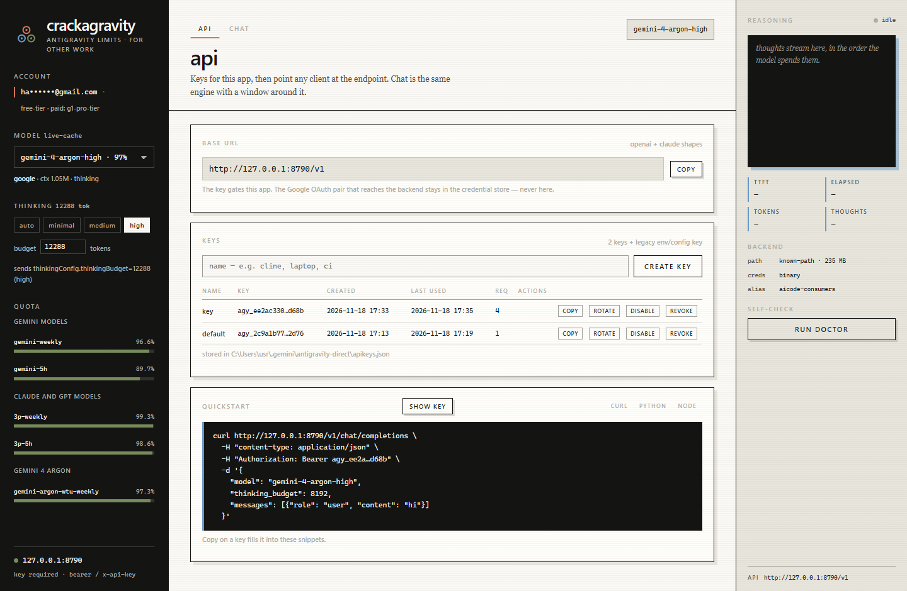
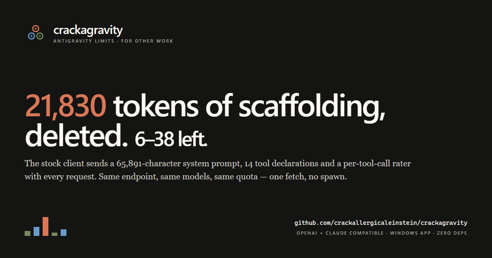

# crackagravity

**Antigravity limits, but for whatever the fuck you want to do with them.**

You have a Google account sitting in the Antigravity client. That client burns
your quota on 16.5k tokens of its own fucking system prompt before your question
even lands. This repo takes the same quota, the same models, the same backend —
and strips every last bit of that vendor scaffolding out of the request.

No harness prompt. No 14-tool roster. No "Proctor" rater sniffing your tool
calls. No 235 MB process shat out per turn. No hub. Just one HTTPS POST with
your actual fucking message in it.



---

## Read this before you touch anything, idiot

The stock CLI (`agy -p "hi"`) costs **21,830 prompt tokens** for a three-word
answer. Why? Because every call drags this bullshit along:

| shit the stock client sends | what it costs you |
|---|---|
| `request.systemInstruction` — 65,891 characters of vendor prompt | ~16,500 tokens |
| `request.tools` — 14 tool declarations you never asked for | ~5,000 tokens |
| a whole second request (`agent_monitoring`) to a "safety rater" per tool call | 2,704 tokens |
| one 235 MB `agy.exe` process, per turn | ~7 seconds of your life |

All of that lives in the **client**. That's the whole trick, and it took reading
the binary to see it. This repo sends **6–38 prompt tokens** for the same answer.
That's not an optimisation. That's deleting the middleman and his bullshit fee.

## What's actually bypassed (and what the fuck isn't)

**Gone, because it was client-side theatre:**

- the 16.5k system prompt — not sent, not needed
- the 14 tool declarations and the agent loop that drove them
- the Proctor / `agent_monitoring` rater — never called, because no tool call is pending
- the 235 MB process spawn — replaced by one `fetch`
- the local hub control plane and its plaintext CSRF token
- the telemetry cosplay some other proxies do (`unleash`, `recordTrajectoryAnalytics`, fake logs). This repo does **not** lick that boot. No fake client registration, none.

**Still there, because it's Google's server, not your client:**

- the content filter on request text. It comes back as a perfectly normal `200`
  with `This request was blocked by Gemini's filters…` in the candidate text.
  No transport trick has ever moved that, and this repo doesn't pretend to.
- model refusals. The model is the model, you muppet.
- per-account quota. `gemini-weekly`, `gemini-5h`, `3p-weekly`, `3p-5h`,
  `gemini-argon-wtu-weekly`. `/v1/quota` shows you the real numbers.

If you came here for "bypass Gemini's filter", fuck off to a different repo. If
you came here because the official client wastes 99.7% of your tokens on
scaffolding, welcome, sit down, this is the one.

## Does the Antigravity window need to be open?

**No, and this is the part that makes people's heads fall off.** The app talks
straight to `daily-cloudcode-pa.googleapis.com`. The IDE, the CLI binary, the
hub — close all of it, uninstall the CLI if you want.

The only thing it needs from that install is the **OAuth refresh token** the
client already dumped into Windows Credential Manager (`gemini:antigravity`).
Read once, cached, refreshed by this repo from then on. That's it.

- no credential store entry? `--login-token <refresh_token>`
- no binary? set `AGY_CLIENT_ID` / `AGY_CLIENT_SECRET` (or install the client once)
- nothing at all? then you have nothing to sell, go sign in somewhere

## Install, and don't pretend this is hard

You need Windows (the credential discovery is wincred), Node 20+, and one
sign-in in the Antigravity client sometime in your life. No npm install. No
build step. No bundled 8 MB mystery binary you can't audit. Nothing to compile,
you absolute gremlin — it's JavaScript, "compile" here means "make sure Node
isn't ancient".

```powershell
git clone https://github.com/crackallergicaleinstein/crackagravity
cd crackagravity

# one-time: find the install, verify the chain, mint your local API key
powershell -ExecutionPolicy Bypass -File core\setup.ps1

# open the fucking app
app\crackagravity.cmd
```

That's the whole installation. If `node` isn't on PATH, that's a you problem —
install it like a grown-up, then run it again. If `setup.ps1` tells you the
keyring check failed, it means you never signed into Antigravity on this
machine; do that once, then stop crying and re-run it.

## Any PC, any folder, any install path

"Does it work on another machine?" is a fair question and most repos answer it
with vibes. Here is what was actually run, on this box, on purpose:

| scenario | how it was tested | result |
|---|---|---|
| repo in a different folder | copied the whole tree to `C:\Users\usr\crackagravity-located-elsewhere` and ran it from there | `--doctor` all OK, **14/14 selftest** |
| run from a different working directory | `cd C:\` then absolute path to the CLI | works, resolves its own paths |
| Antigravity in a nonstandard place, with spaces | copied `agy.exe` to `C:\Users\usr\weird install location\Antigravity Stuff\bin\`, set `AGY_BIN` | found `via env`, real answer `elsewhere-ok` |
| client not installed at all | `AGY_NO_BINARY=1` + cached pair | **14/14 selftest** — binary is not needed once the pair is cached |
| keyring entry renamed | pointed the cache at `bogus:gone` | full credential scan adopted `gemini:antigravity` again |
| no keyring entry | `AGY_REFRESH_TOKEN` seed | supported, tested in isolation |
| binary discovery | known path and running-process branches hit; registry / `PATH` / bounded scan are the same code path | `--where` prints exactly which branch won |

Run this on a machine that misbehaves before you file a bug:

```powershell
node core\cli.mjs --where
```

It prints every candidate in order, the winner, the keyring target, the token
source, the client-pair source and the state directory. No guesswork, no
"works on my machine".

**What "any PC" does not mean.** Three honest limits:

- **Windows.** The credential store is wincred and the discovery shell is
  PowerShell. On Linux/macOS the core client runs fine, but you supply the token:
  `AGY_REFRESH_TOKEN=...`, then `node core/cli.mjs`.
- **Node 20+.** No bundled runtime, no 8 MB mystery binary. Install Node or get
  nothing.
- **A Google account that signed into Antigravity once** — the quota belongs to
  that account, not to the machine.

Everything else is discovered at runtime, and re-discovered when a vendor update
moves it. That is the whole point.

## Plug it into whatever you're running

Two shapes on one port. OpenAI-compatible, Claude-compatible. Keys are `agy_…`,
made and killed in the **API** tab.

```python
from openai import OpenAI

client = OpenAI(base_url="http://127.0.0.1:8790/v1", api_key="agy_…")

r = client.chat.completions.create(
    model="gemini-3.8-flash-low",
    thinking_budget=8192,      # tokens, not vibes. 512…32768, 0 = shut it up
    messages=[{"role": "user", "content": "hi"}],
)
print(r.choices[0].message.content)
```

```bash
curl http://127.0.0.1:8790/v1/messages \
  -H "content-type: application/json" \
  -H "Authorization: Bearer agy_…" \
  -d '{"model":"gemini-4-hydrogen-high","max_tokens":200,
       "thinking":{"type":"enabled","budget_tokens":8192},
       "messages":[{"role":"user","content":"hi"}]}'
```

| endpoint | what it does |
|---|---|
| `POST /v1/chat/completions` | OpenAI: stream, non-stream, `tools`, `tool_choice`, `reasoning_effort`, `thinking_budget` |
| `POST /v1/messages` | Claude: stream, non-stream, `tools.input_schema`, `thinking.budget_tokens` |
| `POST /v1/completions` | grandma mode, text completion |
| `GET /v1/models`, `/v1/models/{id}` | live per-account catalog, `?quota=1`, `?refresh=1` |
| `GET /v1/quota`, `/v1/tier` | real buckets, tier, project |
| `GET /health`, `/v1/doctor` | self-check without burning quota |

Auth: `Authorization: Bearer`, `x-api-key`, or `api-key`. Old `AGY_TOKEN` and
`config.api_key` still work if you're migrating, you lazy sod.

## Thinking is a number, not a personality

The wire knob is `generationConfig.thinkingConfig.thinkingBudget`. The words in
the UI are just presets that write that number. Send a word the model doesn't
carry and the backend spits a 400 at you — `Thinking level MINIMAL is not
supported for this model` — which is why the number is what ships.

| budget | thought tokens it actually spent |
|---|---|
| 1024 | 153 |
| 8192 | 348 |
| 30000 | 1218 |

Same prompt, three budgets, three real measurements. Thoughts stream to
`delta.reasoning` (OpenAI), `thinking_delta` (Claude), and the app's reasoning
panel. `max_tokens` gets raised by the budget automatically because thoughts
count against the output cap — otherwise you'd cap your own answer and look
confused about it.

## The app


Two tabs, because the API is the point:

**API** (default) — base URL with copy, the key table, quickstarts in curl /
python / node that carry the key you clicked. Create, copy, rotate, disable,
revoke. Last-used time and request count per key, so you can see which key is
dead instead of guessing like an idiot.

**Chat** — same engine with a window: model picker, thinking presets plus a bare
token budget box, live reasoning panel with TTFT / elapsed / tokens / thoughts,
and a toolbar with refresh, stop, regenerate, clear and jump-to-bottom. History
survives window restarts. Yes, an app is supposed to have these. You're welcome.

## How it works, for the two of you who care

```
app\crackagravity.cmd
  └─ app/server.mjs                      UI + /api/* + /v1/*
       └─ core/lib/client.mjs            one HTTPS POST per turn
            └─ daily-cloudcode-pa.googleapis.com/v1internal:streamGenerateContent
                 Authorization: Bearer <access token minted from your refresh token>
```

Credential chain, all discovered, nothing hardcoded to your machine:

1. **refresh token** — every generic wincred entry is scanned, the one with a
   Google refresh token in it gets adopted
2. **OAuth client id/secret** — pulled out of the installed `agy.exe`, each pair
   verified against `oauth2.googleapis.com/token` before it's used
3. **binary** — `AGY_BIN` → config → known dirs → registry uninstall entries →
   running process → `PATH` → bounded scan. Only `agy*.exe` counts.
4. **model catalog** — `v1internal:fetchAvailableModels`, per account, cached

And because vendors love breaking shit, all of it re-derives itself when it
stops working:

| update fucks up | what happens |
|---|---|
| client id/secret re-signed | pair marked stale → binary rescanned → every pair re-verified |
| binary replaced or moved | fingerprint (`size:mtime`) mismatch → revalidate → rescan |
| keyring target renamed | full credential scan, next candidate adopted, same pass |
| refresh token rotated | store re-read; if it didn't move, the pair gets rescanned |

Hardening that's actually ported and tested, not README wank:

- **upstream fallback** `daily → sandbox → production`, only on network/5xx, and
  never after the first byte reaches the client. Same day, same token:
  `production` answered **429**, `daily` and `sandbox` answered **200**.
- **account pool** — several refresh tokens rotate per request; 429 gets an
  exponential cooldown, 403 gets ten minutes and dies after three strikes,
  `invalid_grant` dies immediately. One working account and one fake one:
  requests kept flowing, fake one got disabled, working one stayed `ok`.
- **SSE heartbeat** every 15 s, because a thinking model goes quiet and some
  proxy decides your connection is dead.
- **tool calling** with `thoughtSignature` packed into the tool-call id, so the
  loop survives restarts with zero server state. No signature cache to lose.

## Proof, because "trust me bro" is not proof

Run on a real account, 2026-11-18:

```
$ node core\cli.mjs --doctor
OK  binary        …\.gemini\bin\agy.exe (235 MB via known-path)
OK  client_creds  binary · 1071006060591-…
OK  keyring       gemini:antigravity
OK  auth          tier=free-tier project=aicode-consumers
OK  quota         gemini-weekly=97.0% gemini-5h=91.5% 3p-weekly=98.8% …
OK  catalog       31 addressable / 36 total (live)
all good

$ node core\cli.mjs --selftest
PASS health / models_no_key_401 / models_with_key / api_key_header
PASS chat / chat_stream / tool_call / thinking_events
PASS claude_message / claude_stream / thinking_budget
PASS api_key_lifecycle (create → use → revoke → 401)
PASS quota_endpoint
14/14 passed
```

Every Google model in the catalog, one real request each (`--probe`):
**22/24 answered**. `gemini-4-carbon-disabled` is a 404 by design;
`gemini-2.5-pro` was 503 "no capacity" at the time. The two failures are the
server's opinion, not the client's bug — write that down.



## Repo layout

| path | what the fuck is in it |
|---|---|
| `app/` | the app: server, UI, launcher, key store wiring, OpenAI SDK shim |
| `core/` | OAuth discovery, token cache, model catalog, account pool, CLI |
| `legacy-shim/` | old shim that spawns `agy -p` per request, kept for comparison |
| `hub/` | local Antigravity hub client (analysis only) |
| `mitm/` | loopback TLS proxy used to capture/rewrite requests (`dumps/` gitignored) |
| `recon/` | captured system prompt, model catalog, extraction scripts |
| `probe/` | test fixtures from the prompt experiments |
| `tools/` | screenshot capture, publish helper, one-off patches |
| `docs/handoff.md` | deep notes: architecture, findings, severity table, repro |
| `docs/report.md` | the write-up with evidence |

## Security, briefly, because you'll probably leak your own token

- The refresh token is a live credential. It lives in Windows Credential Manager
  and `~/.gemini/antigravity-direct/token.json` (user-profile ACL). **Nothing in
  this repo contains one.** If you ever commit one, revoke it and re-sign in.
- The local API key is a gate for this app only. It never leaves your machine,
  and the app binds `127.0.0.1` by default.
- No fake telemetry, no vendor endpoint getting hammered, no "impersonate the
  official client" cosplay. Every request goes where the official client goes,
  with your account, from your machine.
- The server-side filter is not touched. If you need what it blocks, this repo
  won't get it for you, and that's not a missing feature — it's the boundary.

## FAQ for people who don't read

**Do I need Antigravity open?** No. Only the token it left behind.

**Is the system prompt gone?** Yes. Client-side, deleted. The Proctor rater,
gone. The tools, gone. What's left is Google's content filter and the model's own
opinions, and no local project moves those.

**Will my account get nuked?** This path sends *less* than the official client:
no telemetry replay, no client impersonation beyond a normal UA, no extra
requests. That's a smaller surface than half the proxies on GitHub. No local
project can promise anything about a remote account — anyone who does is lying
to you.

**Which models?** Whatever the account's tier gets. 36 entries / 31 addressable
on free tier, more if you pay. Asked live, never hardcoded — that's why the
catalog doesn't rot like everyone else's.

**Windows only?** The app and credential discovery, yes. The core client is
plain Node and runs anywhere once you feed it `AGY_REFRESH_TOKEN`.

**It says port 8790 already in use.** Then it's already running, genius. Open
the window: `app\launch.ps1`. Or restart it: `app\launch.ps1 -Restart`.

## License

MIT. Go wild. Just don't come crying when you commit your token.
